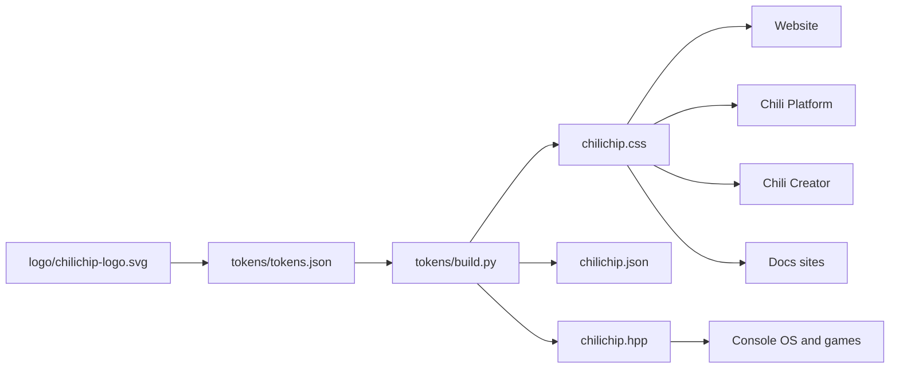

# chilichip design system

One look for everything chilichip makes: the [website](https://chilichip.eu), [Chili Platform](https://platform.chilichip.eu), [Chili Creator](https://creator.chilichip.eu), the docs sites and the chilichip console.

Everything here comes from the logo.

<div class="cc-demo" markdown>
{ width="160" }

<div>
<p style="font-family: var(--cc-font-display); font-weight: 800; font-size: 2.4rem; line-height: 1.1">Sharp. Bright.<br>A little spicy.</p>
<p style="color: var(--cc-muted); font-family: var(--cc-font-mono); font-size: 0.75rem; margin-top: 0.75rem">Three colours, straight edges, hard shadows.</p>
</div>
</div>

## What the logo tells us

| In the logo | Rule in the system | Where to read more |
| --- | --- | --- |
| Three flat colours: two reds and a green | Chili red leads. Leaf green is a small accent. Everything else is neutral. | [Colour](colour.md) |
| Only straight edges | Square corners. No rounded boxes. | [Shape](layout.md#shape) |
| Two reds side by side make the chili look solid | Depth is a second flat tone or a hard offset shadow. No blur, no gradients. | [Depth](layout.md#depth) |
| Diagonal cuts | A cut corner marks the important thing on a page. Use it rarely. | [Cut corners](layout.md#cut-corners) |
| It reads at a tiny size | Every pattern must also work on a 128×128 screen. | [Small screens](small-screens.md) |

## What is in the box

| Thing | File | For |
| --- | --- | --- |
| Logo | [`logo/chilichip-logo.svg`](https://github.com/chili-chip/chilichip-brand/blob/main/logo/chilichip-logo.svg) | Everyone |
| Token source | [`tokens/tokens.json`](https://github.com/chili-chip/chilichip-brand/blob/main/tokens/tokens.json) | People who change the system |
| CSS variables | [`tokens/chilichip.css`](tokens/chilichip.css) | Website, Chili Platform, Chili Creator, docs sites |
| JSON | [`tokens/chilichip.json`](tokens/chilichip.json) | Scripts and other tools |
| C++ header | [`tokens/chilichip.hpp`](tokens/chilichip.hpp) | The console OS and games |
| Reference components | [`assets/components.css`](assets/components.css) | Copy and adapt |

## Quick start

=== "Web"

    Copy [`chilichip.css`](tokens/chilichip.css) into your project and load it first.

    ```html
    <link rel="stylesheet" href="chilichip.css">
    <style>
      body { background: var(--cc-bg); color: var(--cc-text); font-family: var(--cc-font-text); }
      .buy { background: var(--cc-accent); color: var(--cc-on-accent); box-shadow: var(--cc-shadow-button); }
    </style>
    ```

=== "Console"

    Copy [`chilichip.hpp`](tokens/chilichip.hpp) into your game or the OS.

    ```cpp
    #include "chilichip.hpp"

    using namespace chilichip;

    blit::Pen pen(Rgb c) { return blit::Pen(c.r, c.g, c.b); }

    void render(uint32_t time) {
      blit::screen.pen = pen(console::bg);
      blit::screen.clear();
      blit::screen.pen = pen(console::accent);
      blit::screen.rectangle(blit::Rect(0, 32, 128, 16));
    }
    ```

More in [Tokens](tokens.md).

## How it fits together



## Status

This is the first version. Work is tracked in [chilichip-brand #7](https://github.com/chili-chip/chilichip-brand/issues/7). Some choices wait for the brand kit; see [Open questions](open-questions.md).
