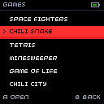
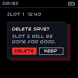
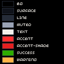
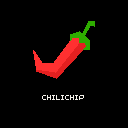

# Small screens

The chilichip console has a 128×128 pixel screen, about 27 mm wide. There is no room for web patterns, so the system gets simpler. The idea stays the same: black, bone, one red thing.

!!! note "Examples, not the final OS"
    The pictures on this page show how the system looks at 128×128. They are drawn with the real console font. The console OS itself is designed in [chili-chip/32blit-sdk](https://github.com/chili-chip/32blit-sdk).

<div class="screens" markdown>
<figure markdown>
{ .pixel }
<figcaption>List: the selected row is the only red thing.</figcaption>
</figure>
<figure markdown>
{ .pixel }
<figcaption>Dialog: hard shadow, one cut corner.</figcaption>
</figure>
</div>

## Colour

The console uses a short list of roles. The background is pure black: on the OLED a black pixel is off, which saves power and looks deepest.

<div class="screens" markdown>
<figure markdown>
{ .pixel }
</figure>
</div>

--8<-- "console.md"

All of these are in [`chilichip.hpp`](tokens/chilichip.hpp).

| Rule | Why |
| --- | --- |
| Background is `bg` (black). Use `surface` only for panels on top. | Black pixels are off on the OLED. |
| Text is `text` or `muted`. | Both pass 4.5:1 on black. |
| Text on red is `on-accent`. | Bone on red is hard to read at 8 px. |
| One `accent` area per screen: the selection. | Red means "you are here". |
| `accent-shade` is a 2 px strip under a red area. | The same lit face and shaded face as the logo. |
| Show state with a mark too (`>` or an icon). | Colour alone fails for some people and on some panels. |

The display stores colours as RGB565, so they shift a little. `Rgb::rgb565()` in the header gives the stored value. The console comes with an OLED or a TFT screen. The TFT is less saturated and its black is dark grey, so check both before you ship.

## Grid

| Thing | Size |
| --- | --- |
| Screen | 128×128 px |
| Base unit | 8 px. The screen is 16×16 units. |
| Gaps | 2, 4, 8 or 16 px |
| Side margin | 4 px |
| Status bar | 12 px high, with a 1 px `line` under it |
| List row | 16 px high. Six rows fit under the status bar with room for hints. |
| Hint line | The last 12 px: what A and B do |
| Lines and borders | 1 px |

Everything sits on whole pixels. Nothing is scaled, rotated or smoothed.

## Type

The console has its own bitmap font (`minimal_font` in the 32blit SDK): 8 px high, variable width, capitals only. The web fonts are not used here.

| Rule | Detail |
| --- | --- |
| About 20 characters fit on a line. | Measure real strings: letters are 2 to 7 px wide. |
| Line height is 9 px or more. | 8 px glyph plus 1 px gap. |
| No bold, no sizes. | Use `text` and `muted`, position and the red selection to show order. |
| Keep labels to one or two words. | "Delete", "Keep", "Open". |
| Do not scale the font by 1.5. | Only whole steps: 2× for a title if you must. |

## Shape and depth

The web rules carry over, in pixels.

| Web | Console |
| --- | --- |
| Square corners | Square corners. Never fake a round corner with pixels. |
| `4px 4px 0` button shadow | A 2 px `accent-shade` strip under the red area |
| Card shadow | A filled `chili-deep` rectangle, 4 px down and right |
| Cut corner 12 px | Cut corner 6 px, on dialogs only |
| Focus outline | The red selection row or a 1 px `text` border |

## Motion and burn-in

| Rule | Why |
| --- | --- |
| Move in whole pixels and finish within 150 ms. | Slow fades look muddy at this size. |
| Do not blink faster than 2 times per second. | It is tiring and can be unsafe. |
| Keep bright static areas small. | An OLED wears where it stays bright. Bars are `line` on black, not filled. |
| Dim, then sleep, when idle. | Saves the panel and the battery. |

## Logo

The vector logo does not survive below about 24 px. On the console, and for favicons, use a pixel version with hard edges.

<div class="screens" markdown>
<figure markdown>
{ .pixel }
<figcaption>Splash: 64 px logo on black.</figcaption>
</figure>
<figure markdown>
{ .pixel style="width: 128px; background: #000" }
<figcaption>64 px</figcaption>
</figure>
<figure markdown>
{ .pixel style="width: 128px; background: #000" }
<figcaption>32 px</figcaption>
</figure>
<figure markdown>
{ .pixel style="width: 128px; background: #000" }
<figcaption>16 px</figcaption>
</figure>
</div>

!!! warning "Drafts"
    These pixel logos are made by a script from the SVG. They are good enough to try things out. The 16 px one needs hand tuning before it ships. See [Open questions](open-questions.md).

## Make the pictures again

The examples are drawn by [`tools/console_mockups.py`](https://github.com/chili-chip/chilichip-brand/blob/main/tools/console_mockups.py) from the tokens and the SDK font. Run it after you change a console colour:

```sh
pip install pillow
python3 tools/console_mockups.py ../32blit-sdk/32blit/graphics/font.cpp
```
