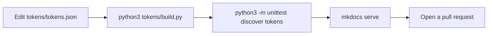

# Tokens

A token is a named design value, like `--cc-accent` or `--cc-space-4`. Products use the names, never the raw values. When a value changes here, every product follows.

## Files

| File | What it is | Edit it? |
| --- | --- | --- |
| [`tokens/tokens.json`](https://github.com/chili-chip/chilichip-brand/blob/main/tokens/tokens.json) | The source. Every value lives here. | Yes |
| [`chilichip.css`](tokens/chilichip.css) | CSS custom properties with the prefix `--cc-`. Dark by default. | No, generated |
| [`chilichip.json`](tokens/chilichip.json) | The same values as plain JSON, colours as hex. | No, generated |
| [`chilichip.hpp`](tokens/chilichip.hpp) | C++ header with the colours and the console roles. | No, generated |

## Names

| Group | Pattern | Example |
| --- | --- | --- |
| Palette colour | `--cc-<colour>` | `--cc-chili`, `--cc-ink-2` |
| Role | `--cc-<role>` | `--cc-accent`, `--cc-surface`, `--cc-link` |
| Font | `--cc-font-<name>` | `--cc-font-display` |
| Text size | `--cc-text-<step>` | `--cc-text-sm` |
| Line height | `--cc-leading-<name>` | `--cc-leading-normal` |
| Letter spacing | `--cc-tracking-<name>` | `--cc-tracking-label` |
| Space | `--cc-space-<step>` | `--cc-space-4` |
| Radius | `--cc-radius-<name>` | `--cc-radius-none` |
| Cut corner | `--cc-cut-<size>` | `--cc-cut-md` |
| Shadow | `--cc-shadow-<name>` | `--cc-shadow-button` |
| Motion | `--cc-motion-<name>` | `--cc-motion-fast` |

Use roles in components. Use palette colours only when you define a new role.

## Use it in a web project

Copy `chilichip.css` from a tagged release of this repo into your project. Do not link to it from another site at run time.

=== "Plain CSS"

    ```html
    <link rel="stylesheet" href="chilichip.css">
    ```

    ```css
    .panel {
      padding: var(--cc-space-5);
      border: 1px solid var(--cc-line);
      background: var(--cc-surface);
      color: var(--cc-text);
    }
    ```

=== "Angular (Chili Platform)"

    Put the file in `src/styles/` and list it in `angular.json` before `styles.scss`. Then point the old names in `_tokens.scss` at the new ones, and remove them one by one.

    ```json
    "styles": ["src/styles/chilichip.css", "src/styles.scss"]
    ```

    ```scss
    :root {
      --chili: var(--cc-accent);
      --text: var(--cc-text);
      --muted: var(--cc-muted);
      --line: var(--cc-line);
      --surface: var(--cc-surface);
    }
    ```

=== "React (Chili Creator)"

    Import the file once, before `styles.css`.

    ```ts
    import './chilichip.css';
    import './styles.css';
    ```

=== "MkDocs Material"

    Add the file to `extra_css` and map Material's variables. This site does it in [`assets/extra.css`](assets/extra.css).

    ```css
    [data-md-color-scheme="slate"] {
      --md-default-bg-color: var(--cc-ink-0);
      --md-default-fg-color: var(--cc-bone);
      --md-accent-fg-color: var(--cc-chili);
      --md-typeset-a-color: var(--cc-leaf-bright);
    }
    ```

=== "Hugo with Blowfish (website)"

    Blowfish wants colour ramps as `r, g, b` numbers in a scheme file. Take the values from `chilichip.json` and set chili as the primary colour and leaf as the secondary. For custom styles in `assets/css/custom.css`, load `chilichip.css` and use the `--cc-` variables directly.

### Light and dark

Dark is the default. Add `data-theme="light"` to `<html>`, or to any element, to switch that part to light.

```html
<html data-theme="light">
```

To follow the system setting, set the attribute with one line of script:

```html
<script>
  if (matchMedia('(prefers-color-scheme: light)').matches) document.documentElement.dataset.theme = 'light';
</script>
```

### Old names in Chili Platform and Chili Creator

Both apps already use variables that are close to these tokens. This table shows what each becomes.

| Chili Platform | Chili Creator | Token | Value change |
| --- | --- | --- | --- |
| `--chili`, `--accent` | `--color-chili` | `--cc-accent` | `#ff3b3b` to `#ff3030` (the logo red) |
| `--chili-deep` | `--color-chili-deep` | `--cc-accent-deep` | Same |
| `--chili-hot`, `--danger` | `--color-chili-hot` | `--cc-danger` | Orange `#ff6b35` to chili. Orange is not in the logo. |
| `--phosphor`, `--link`, `--focus`, `--success` | `--color-phosphor` | `--cc-link`, `--cc-focus`, `--cc-success` | Mint `#7dffb3` to leaf `#6fe33a` |
| `--amber`, `--warning` | `--color-amber` | `--cc-warning` | Same |
| `--bg-0` | `--color-bg-0` | `--cc-bg` | Same |
| `--bg-2` | `--color-bg-2` | `--cc-surface-sunken` | Same |
| `--bg-1`, `--surface` | `--color-bg-1` | `--cc-surface` | Same |
| | `--color-bg-3` | `--cc-surface-raised` | Same |
| `--line` | `--color-line` | `--cc-line` | Same |
| `--text` | `--color-text` | `--cc-text` | Same |
| `--muted` | `--color-muted` | `--cc-muted` | Same |
| `--on-accent` | `--color-on-accent` | `--cc-on-accent` | Same |
| `--font-display`, `--font-mono`, `--font-pixel` | Same names | `--cc-font-display`, `--cc-font-mono`, `--cc-font-pixel` | Same |
| `--space-*`, `--text-*` | | `--cc-space-*`, `--cc-text-*` | Same |
| `--leading` | | `--cc-leading-normal` | Same |
| `--shadow-button`, `--shadow-card`, `--shadow-pop` | | `--cc-shadow-*` | Red tint follows the new chili |
| `--duration-fast`, `--duration`, `--ease` | | `--cc-motion-fast`, `--cc-motion-normal`, `--cc-motion-ease` | Same |

## Use it on the console

Copy `chilichip.hpp` into the project. It has no dependencies.

```cpp
#include "chilichip.hpp"

using namespace chilichip;

// 32blit: turn a token into a pen
blit::Pen pen(Rgb c) { return blit::Pen(c.r, c.g, c.b); }

blit::screen.pen = pen(console::accent);       // a role
blit::screen.pen = pen(color::leaf);           // a palette colour
uint16_t raw = console::text.rgb565();         // the value the display stores
```

See [Small screens](small-screens.md) for how to use the colours.

## Use it in a script

```python
import json

tokens = json.load(open("chilichip.json"))
tokens["color"]["chili"]            # "#ff3030"
tokens["theme"]["light"]["link"]    # "#1e7300"
```

## Change a token



1. Edit `tokens/tokens.json`.
2. Run `python3 tokens/build.py`. It writes the CSS, JSON, header and the tables in these docs.
3. Run `python3 -m unittest discover tokens`. The tests check that:
    - the logo colours match `logo/chilichip-logo.svg`,
    - every text role has a contrast of 4.5:1 or more,
    - the generated files are up to date.
4. If you changed a console colour, [draw the console pictures again](small-screens.md#make-the-pictures-again).
5. Look at the result with `mkdocs serve`, then open a pull request.

CI runs the same tests and builds the docs on every pull request.

## Versions

Releases are git tags (`v0.1.0`, `v0.2.0`, …). Products copy the files from a tag and note the tag in a comment at the top. A change of a value is a minor version. A renamed or removed token is a major version.
